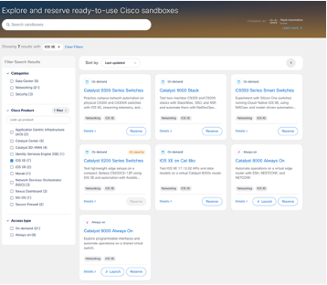
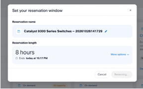
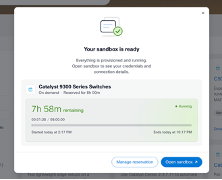
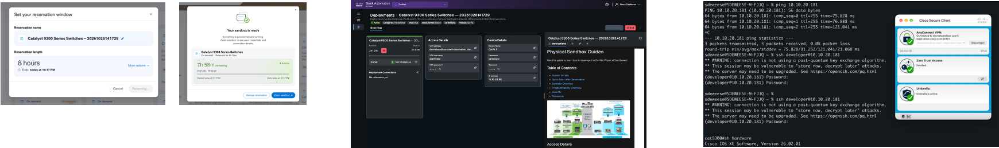
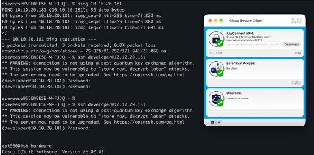

# Cisco IOS XE Terraform with NETCONF examples

This repo includes small, independent examples for managing Cisco IOS XE with the CiscoDevNet IOS XE Terraform provider over NETCONF. The `vlan/` and `acl/` folders are worked Terraform configurations with separate local state. The `iosxe_*/` folders contain provider-release resource examples and per-resource guides. Treat those as starting configurations: verify feature support, review the sample values, and follow each guide’s before/apply/readback/destroy steps before using a sandbox.

## Examples

| Example or index | Use case | Guide |
| --- | --- | --- |
| [`vlan/`](vlan/) | Manage one Layer 2 VLAN with all Terraform configuration in one `.tf` file. | [`vlan-readme.md`](vlan/vlan-readme.md) |
| [`acl/`](acl/) | Configure the same extended ACL on two switches using separate provider, variable, and resource files. | [`acl-readme.md`](acl/acl-readme.md) |
| [`provider-type-index.md`](provider-type-index.md) | Browse the individual `iosxe_*` resource folders and their matching data source examples in provider v1.1.1. | [`provider-type-index.md`](provider-type-index.md) |
<!-- Temporarily hidden; restore when the multi-device example is ready to be included.
| [`multi-device-acl/`](multi-device-acl/) | Configure the same ACL on two switches using aliased providers and shared local values. | [`multi-device-acl-readme.md`](multi-device-acl/multi-device-acl-readme.md) |
-->

The VLAN and ACL guides describe their goal, Terraform behavior, requirements, CLI checks before and after applying, and cleanup. Review those guides before running the examples. Each provider-type folder has its own provider, credential variables, tfvars template, resource example, and matching data source when available. Review the per-resource guide and adapt the feature values to your reservation before applying.

## Provider coverage and runnable examples

This repository uses CiscoDevNet/iosxe **v1.1.1**, the latest release at the time of this update. Provider v1.x uses NETCONF only. Its schema contains **142 resource types** and **138 data source types**. The provider documentation groups these under **23 feature sections**.

The worked sandbox examples in this repository currently cover **2 feature areas**: VLANs and extended IP ACLs. The other **140 resource types** have their own root-level folders. Each contains provider settings, variables, a tfvars template, an official v1.1.1 resource example, and a per-resource guide; matching data sources are included where available. The guides use a common CLI-before, Terraform plan/apply, CLI/data-source readback, and cleanup sequence. The configurations have not been individually tested against every sandbox model, and some features are not supported on Catalyst 9300. For create examples, the data source is deliberately read after apply; use the initial CLI check as the before-state because a data source cannot read an object that does not yet exist.

| Coverage | Count | Meaning |
| --- | ---: | --- |
| Provider resource types | 142 | Schema in provider v1.1.1 |
| Provider data source types | 138 | Schema in provider v1.1.1 |
| Types with both forms | 138 | Resource plus matching data source |
| Resource-only types | 4 | `iosxe_cli`, `iosxe_commit`, `iosxe_interface_ethernets`, `iosxe_save_config` |
| Provider documentation feature sections | 23 | AAA, BFD, BGP, CTS, Crypto, EIGRP, EVPN, Flow, General, IS-IS, Interface, L2VPN, MDT, MPLS, Management, Multicast, OSPF, QoS, Routing, Security, Switching, System, VRF |
| Runnable example feature areas here | 2 | VLANs and extended IP ACLs |

See the [provider type index](provider-type-index.md) for every resource and data source. The [versioned Terraform Registry docs](https://registry.terraform.io/providers/CiscoDevNet/iosxe/1.1.1/docs) contain the full provider reference.

## Requirements

- Terraform CLI `>= 1.3.0`
- Cisco IOS XE with NETCONF enabled (`netconf-yang`) and reachable on TCP/830
- CiscoDevNet/iosxe provider `~> 1.1.1` (provider v1.x uses NETCONF only)
- A NETCONF account with permission to read and configure the resources in the example

## Set up Terraform locally and reserve a sandbox

Terraform runs on your computer and connects to the sandbox switch over NETCONF. You need a local copy of this repository, and your computer must be able to reach the switch on TCP/830.

### 1. Install Terraform

Install the Terraform CLI for your operating system using [HashiCorp's official installation instructions](https://developer.hashicorp.com/terraform/install). The instructions cover macOS, Windows, and Linux. Then open a terminal and confirm it is installed:

```sh
terraform version
```

### 2. Clone this repository

Clone the public repository onto the same computer where Terraform is installed:

```sh
git clone https://github.com/sdeweese/terraform-examples.git
cd terraform-examples
```

### 3. Choose and reserve the sandbox

Open the [Cisco DevNet Sandbox catalog](https://developer.cisco.com/sandbox/search), filter for **IOS XE**, and choose the **on-demand Catalyst 9300 Series Switches** sandbox for the single-switch VLAN example. This gives you a private Catalyst 9K environment for configuration work. A Cisco account is required; Cisco's [Sandbox overview](https://developer.cisco.com/docs/sandbox/) explains the reservation process and sandbox types.

This screenshot shows the IOS XE filter and the Catalyst 9300 Series Switches listing. Select the on-demand option and review its details before reserving it.



Choose a reservation window and submit the reservation. This dialog is where you set how long you need the sandbox; check the selected duration before confirming.



Wait until the sandbox is ready. The ready screen confirms that provisioning finished and provides the action to open the reservation.



Open the reservation to find the device access information and sandbox instructions. Use the management IP, username, password, and VPN instructions shown for **your** reservation. The screenshot shows example values; they may differ from yours.



### 4. Connect to the sandbox and check device access

Follow the connection instructions for your reservation. If it requires a VPN, connect with the specified VPN client and profile before using the device. Then, from your computer's terminal, verify reachability and log in over SSH. Replace `RESERVATION_USERNAME` if your reservation uses a different username:

```sh
ping 10.10.20.181
ssh RESERVATION_USERNAME@10.10.20.181
```

The screenshot shows the VPN connected and a terminal session reaching the switch over SSH. Your VPN profile, address, and login prompt may look different. The example uses `10.10.20.181`; update it if your reservation provides another management IP. At the IOS XE prompt, confirm you reached the switch and check that NETCONF is enabled. Terraform requires `netconf-yang` and access to TCP/830.



### 5. Add your reservation values to the local VLAN variables file

In your cloned repository, create `terraform.tfvars` inside `vlan/` with the address and credentials from your reservation. The example template has the address `10.10.20.181`; change it if needed. Replace both credential placeholders with the username and password shown in your reservation:

```hcl
switch_ip       = "10.10.20.181"
switch_username = "YOUR_RESERVATION_USERNAME"
switch_password = "YOUR_RESERVATION_PASSWORD"
```

`terraform.tfvars` is local and ignored by Git; do not commit it. The `.tfvars.example` file is only a template. Keep the reservation details private.

### 6. Run and verify the VLAN example

Follow [`vlan/vlan-readme.md`](vlan/vlan-readme.md) for the full before/apply/after/destroy workflow. It has you check the current VLAN list first, select a VLAN ID that is absent from the switch, run Terraform from the `vlan/` directory, verify the change with IOS XE show commands, then destroy the managed VLAN and verify it is removed. The initial plan keeps the data source enabled and shows `name = null` when the selected VLAN is absent; after apply, run another plan to read back the created VLAN.

For examples that configure two switches, reserve or use an environment with two independently addressable devices. A switch stack can appear to Terraform as one device, even if it contains multiple physical members. Do not apply configuration to an **Always On** sandbox, which is shared with other users; Cisco recommends on-demand sandboxes for configuration changes.

## Run an example

Each example is in its own folder directly under the repository root. Run Terraform from the example folder. For example:

```sh
cd vlan
```

If you completed Step 5 above, your local `terraform.tfvars` is ready and Terraform will load it automatically. Otherwise, create it in this folder with the address and reservation credentials. You can start from the template by copying it, but copying is optional:

```sh
cp terraform.tfvars.example terraform.tfvars
```

Copying is optional; you can create `terraform.tfvars` yourself. Terraform automatically loads `terraform.tfvars`, while `.example` is just a template. The root `.gitignore` keeps the real `.tfvars` file out of Git, but Terraform still reads it normally.

Then initialize, validate, and review the plan:

```sh
terraform init
terraform validate
terraform plan
```

After reviewing the target device and planned changes, apply without an interactive confirmation prompt:

```sh
terraform apply --auto-approve
```

To try another example, change into its folder and use that folder's `terraform.tfvars.example`. Variable names can differ; each guide lists what to update.

## Terraform commands

| Command | What it does | When to use it | Notes |
| --- | --- | --- | --- |
| `terraform plan` | Reads the current device settings and previews how they differ from the `.tf` files. It does not apply the proposed changes. | Before applying changes, to check which devices and settings Terraform plans to affect. | Read the whole plan. Check device addresses, resource names, and any planned deletes or replacements. |
| `terraform apply --auto-approve` | Builds a fresh plan, applies it, and updates Terraform's state. | After checking the plan and deciding the changes are intended. | `--auto-approve` is optional. Include it to skip Terraform's confirmation prompt; without it, Terraform asks you to approve the plan before applying. Check `terraform plan` immediately beforehand, confirm the target devices, and stop if the configuration or device has changed since that review. Apply can change or delete device configuration. |
| `terraform destroy --auto-approve` | Deletes resources tracked in the current example's state. | To clean up resources created for that example, when nothing else depends on them. | `--auto-approve` is optional. Include it to skip Terraform's confirmation prompt; without it, Terraform asks you to approve the destroy plan. Preview the deletion with `terraform plan -destroy`; confirm the folder and state are correct. If the configuration, state, or device changed since the review, plan again. Destroy does not restore earlier device settings; it deletes tracked resources, including ones that may have existed before Terraform if they were imported. |

Terraform reads current device settings during normal `plan` and `apply` operations. If you want to learn about Terraform's separate refresh-only mode, see [HashiCorp's refresh-only guide](https://developer.hashicorp.com/terraform/tutorials/state/refresh).

## Terraform files and folders

Terraform describes the result you want on a device. The provider connects Terraform to your Cisco IOS XE device, resources describe changes to make, and `terraform plan` previews those changes before `terraform apply --auto-approve` sends them. Terraform also keeps state so it can track what it manages.

Terraform reads every `.tf` file in the folder where you run its commands and treats them as one configuration. The filenames are labels for people; Terraform does not require these exact names. The `vlan/` example puts everything in `main.tf` to keep it simple. The ACL examples split things into files so related settings are easier to find.

| File | What it does | Why an example might use it |
| --- | --- | --- |
| `main.tf` | Often holds the main configuration: provider setup, resources, data sources, and outputs. | Convenient for a small example. The name is a convention; Terraform does not treat it specially. |
| `provider.tf` | Says which provider plugin to use and how to connect it to the device. | Keeps connection and provider settings easy to find, especially when targeting multiple switches. |
| `variables.tf` | Declares the input values the configuration expects, such as switch addresses and credentials. It can set safe defaults for optional inputs. | Separates the input definitions from the configuration that uses them. |
| `<feature>.tf` (such as `acl.tf`) | Describes a particular part of the device configuration, usually with resources and sometimes data sources or outputs. | Helps organize larger examples by what they configure. It is still loaded together with the other `.tf` files in that folder. |
| `terraform.tfvars` | Supplies actual values for the variables, such as your switch IP and password. Terraform automatically loads this filename. | Keeps your device-specific values out of the reusable configuration. This local file is ignored by Git in this repository. |
| `terraform.tfvars.example` | Shows the variable names and example values to start from. Terraform does not load this filename automatically. | Provides a shareable template. Copying it to `terraform.tfvars` is optional; you can create `terraform.tfvars` yourself. |
| `.terraform.lock.hcl` | Records the selected provider version and package checksums. | Helps keep provider installs consistent between runs. Commit this file with the example. |
| `terraform.tfstate` (local backend) | Stores Terraform's record of the resources it manages and their latest known values. | Lets Terraform compare the device with your configuration on later runs. It can contain sensitive values; keep it private. |

You do not need every file for every example. For instance, the VLAN example puts its provider settings, variables, and VLAN resource in one file. The ACL examples put those parts in separate files. Terraform works the same way either way.

Inside the `.tf` files, a `resource` describes a setting Terraform should manage on the switch. This is similar to entering configuration commands, but Terraform also records the resource in state and compares the device with the configuration you declared. A `data` block reads existing settings without changing them, similar to a `show` command. An `output` displays selected values after Terraform runs.

Each example folder has its own configuration and local state. If you run Terraform from `vlan/`, it reads the `.tf` files in `vlan/`. It does not read files from `acl/` or another example folder. The lock file records the provider version and checksums; the state file tracks resources Terraform manages. Terraform downloads the provider into `.terraform/`.

State and saved plan files can contain sensitive information, so do not share them publicly. Marking a variable `sensitive` hides it in some Terraform output; it does not encrypt or remove its value from state. Use `terraform destroy --auto-approve` from the same example folder and state that you used for `terraform apply --auto-approve`. It deletes the managed resources in that state; it does not restore settings that were already on the device before Terraform. Follow the cleanup instructions in that example's guide.

## More information

- [Cisco IOS XE provider documentation (Terraform Registry, version 1.1.1)](https://registry.terraform.io/providers/CiscoDevNet/iosxe/1.1.1/docs)
- [CiscoDevNet IOS XE provider source on GitHub](https://github.com/CiscoDevNet/terraform-provider-iosxe)
- [Terraform language documentation (HashiCorp)](https://developer.hashicorp.com/terraform/language)
