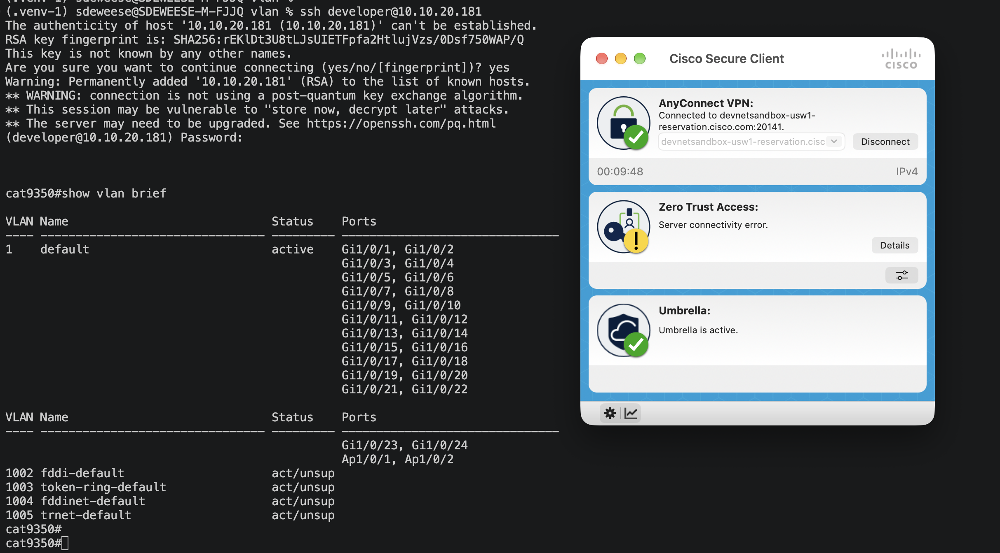
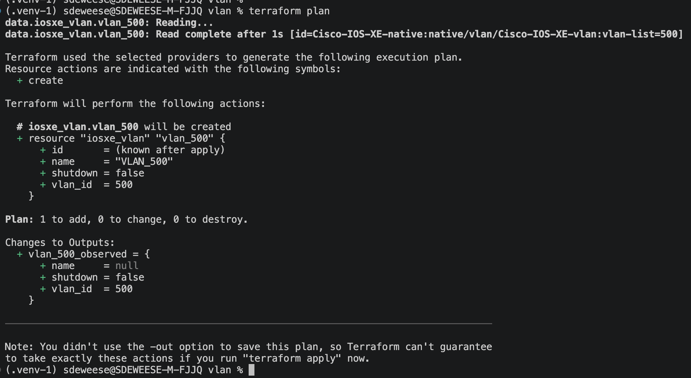
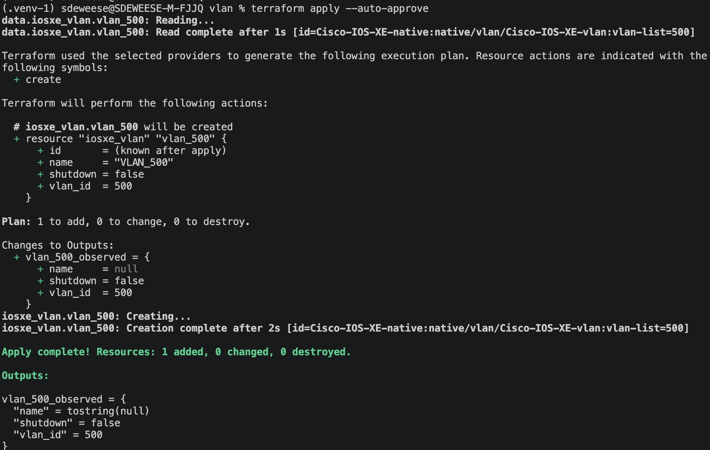
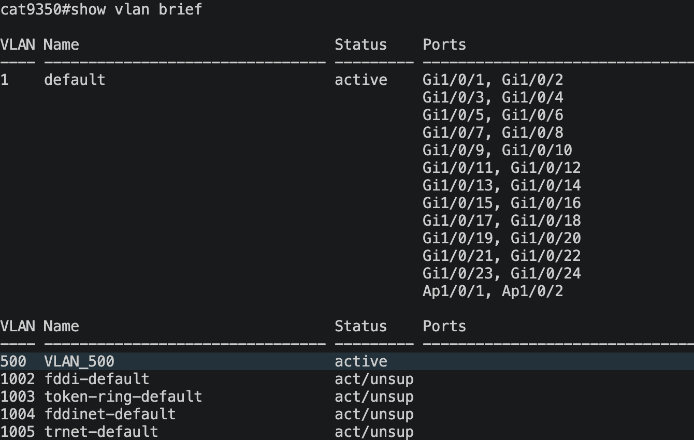
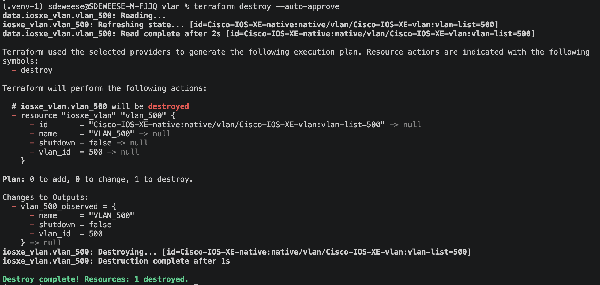
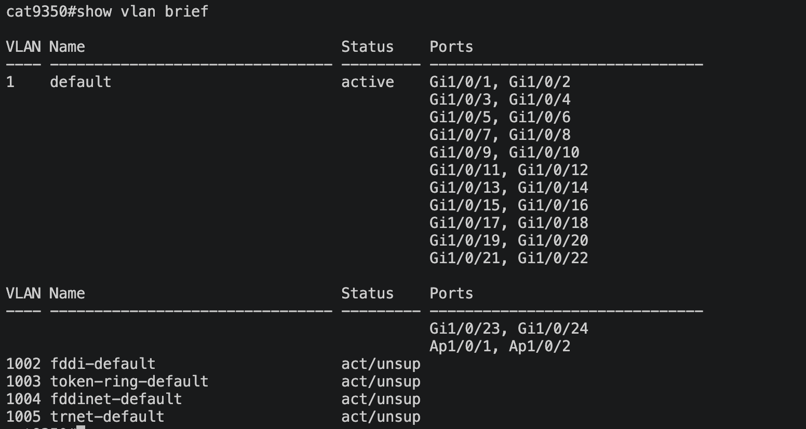

# Manage one VLAN on Cisco IOS XE

This example uses Terraform and NETCONF to manage a Layer 2 VLAN on one switch. All Terraform configuration is in `main.tf`.

> **Provider update:** This configuration now uses CiscoDevNet/iosxe v1.1.1, which uses NETCONF only. The CLI output and device screenshots below were captured during an earlier v0.15.0 run. They show the intended VLAN before/apply/destroy results, but have not been recaptured with v1.1.1. The current configuration passes `terraform validate`; it has not been applied to a device with v1.1.1.

> **Choose your device:** If you are using the prepared sandbox in this local checkout, continue with its current `terraform.tfvars` values and follow this guide. The sandbox example uses `10.10.20.181`; its credentials come from the reservation. If you cloned the public repository or are using your own switch, create `terraform.tfvars` from `terraform.tfvars.example` and replace the IP, username, and password with the values for your reservation or device. The real `terraform.tfvars` file is ignored by Git and is not included in a fresh clone.

## Goal

Create a new Layer 2 VLAN that is not already present on the target switch, then read it from the switch to verify the result. This example uses VLAN 500 named `VLAN_500`.

## What Terraform changes

| Item | Behavior |
| --- | --- |
| Provider | `CiscoDevNet/iosxe` `~> 1.1.1`, using NETCONF over SSH on TCP/830 |
| Resource | Creates the example VLAN with `name = "VLAN_500"` and `shutdown = false` |
| Data source | Reads the example VLAN after it exists and exposes the current values as `vlan_500_observed` |
| Not included | No SVI, IP address, default gateway, or switchport configuration |

Provider references: [`iosxe_vlan` resource](https://registry.terraform.io/providers/CiscoDevNet/iosxe/1.1.1/docs/resources/vlan) · [`iosxe_vlan` data source](https://registry.terraform.io/providers/CiscoDevNet/iosxe/1.1.1/docs/data-sources/vlan).

## Before you start

- Terraform CLI `>= 1.3.0`
- IOS XE with NETCONF enabled (`netconf-yang`) and reachable on TCP/830
- A NETCONF account with permission to read and configure VLANs
- The target switch's management IP or hostname, username, and password

Create a local `terraform.tfvars` file in this folder with your switch connection values. The example template uses `10.10.20.181` for `switch_ip`; change it if your reservation gives you a different management address. Replace the sample username and password with the credentials provided for your sandbox reservation. Terraform automatically loads a file with that exact name. If you want to start from the sample template, copying it is optional:

```sh
cp terraform.tfvars.example terraform.tfvars
```

Edit `terraform.tfvars` with the correct switch IP or hostname and the username and password from your reservation. Git ignores this local file so credentials are not committed; Terraform still reads it normally. The `.example` template is tracked by Git and is not loaded automatically.

## 1. Check the switch first

Choose a VLAN ID that is not already configured on your target switch. This example uses ID 500. Check the current VLAN list first:

```text
Switch# show vlan brief
```

Your switch will display its current VLANs here. The output varies by device; check that the VLAN ID you selected is not listed before continuing.

This screenshot records the pre-Terraform check for the example sandbox: SSH reaches the IOS XE CLI, and `show vlan brief` shows VLAN 500 is absent. For your own reservation or device, repeat the check and confirm your selected VLAN ID is absent before continuing.



The example uses VLAN ID 500, but your chosen ID must be absent from your target switch. If VLAN 500 already exists, choose another unused ID. In `main.tf`, update `vlan_id` and `name` in the resource, and update `vlan_id` in the data source. The Terraform labels `vlan_500` and `vlan_500_observed` can stay as written; they do not set the switch's VLAN ID. Use your chosen ID in the CLI commands below. Do not change or destroy an existing VLAN for this example.

> **Important:** `terraform destroy --auto-approve` deletes the VLAN resource without an interactive confirmation prompt. It does not restore a VLAN that existed before Terraform. Do not destroy a pre-existing VLAN or one used by other configuration.

Leave the data source and output enabled for the first plan. In the captured run below, the data source read completes with `name = null`, while the CLI check shows VLAN 500 is absent; Terraform then plans to create it. If the data source returns a name or the CLI shows that VLAN ID already exists, stop and choose an unused ID before applying.

Before creating a VLAN, check that it is not needed by an SVI, trunk, access port, or another device configuration.

## 2. Plan and apply

Run Terraform from this folder. Terraform combines `.tf` files in the current directory; it does not load `.tf` files from sibling example folders.

Initialize the working directory and install the provider version selected by this example:

```sh
terraform init
```

The lock file selects provider v1.1.1. During this update, `terraform init -upgrade` installed that version:

```text
- Finding ciscodevnet/iosxe versions matching "~> 1.1.1"...
- Installing ciscodevnet/iosxe v1.1.1...
- Installed ciscodevnet/iosxe v1.1.1 (signed by a HashiCorp partner)
Terraform has been successfully initialized!
```

On a fresh clone, `terraform init` will install the version recorded in the committed lock file. Initialization does not test device connectivity.

Then validate the configuration and preview the change:

```sh
terraform validate
terraform plan
```

This captured plan shows the data source read completing with `name = null`, followed by one VLAN resource to add and no changes or deletions. Together with the before-state CLI check, it confirms VLAN 500 is absent and is the planned addition. The successful data source read also confirms Terraform reached the switch. Compare your own plan with your device state and do not apply if the VLAN already exists or Terraform targets an unexpected device.



After confirming the plan, apply without an interactive confirmation prompt:

```sh
terraform apply --auto-approve
```

The captured apply completed successfully and created VLAN 500. Its output still shows `name = null` because Terraform read the data source before it created the VLAN during this same apply. That output is the earlier read, not a post-create readback; use the next step to verify the live value.



## 3. Read and verify the result

Keep the data source and output enabled. After the first apply, run a fresh plan. Terraform reads the VLAN again, and the data source should now show its live values, including `name = "VLAN_500"`, `shutdown = false`, and `vlan_id = 500`:

```sh
terraform plan
```

Review `vlan_500_observed`. The expected plan has no resource changes. If the data source still shows `name = null`, check the device with `show vlan id 500` and investigate before treating the readback as successful. When the data source shows the live values and the plan has no resource changes, apply to save the refreshed output in Terraform's state, then display it:

```sh
terraform apply --auto-approve
terraform output vlan_500_observed
```

This apply records the data source result and output. It should not change the VLAN when the plan shows no resource changes.

At the IOS XE CLI, check the VLAN directly (the example uses ID 500):

```text
Switch# show vlan id 500
```

The captured `show vlan brief` output after apply shows VLAN 500 named `VLAN_500` with status `active`. It has no ports assigned, as expected for this example. This is the device-side confirmation that the VLAN was created:



The focused `show vlan id 500` command should return the VLAN details, including:

```text
VLAN Name                             Status    Ports
---- -------------------------------- --------- -------------------------------
500  VLAN_500                         active
```

## 4. Clean up

If the VLAN ID you selected was absent before this test and is dedicated to it, review the destroy plan and run without an interactive confirmation prompt:

```sh
terraform destroy --auto-approve
```

The captured run refreshed the VLAN state, planned one deletion, and reported `Destroy complete! Resources: 1 destroyed.` This confirms Terraform completed the destroy operation. Check the switch afterward to confirm the VLAN is absent:



At the IOS XE CLI, verify that the selected ID is absent (the example uses ID 500):

```text
Switch# show vlan id 500
VLAN id 500 not found in current VLAN database
```

The captured post-destroy `show vlan brief` output confirms VLAN 500 is gone. The switch shows the same VLANs as the pre-test output: VLAN 1 and the default VLANs 1002–1005. This demonstrates the example returned the VLAN list to its original state.



## Files in this folder

- `main.tf` — provider requirement, provider configuration, variables, VLAN resource, data source, and output.
- `terraform.tfvars.example` — tracked template for local switch connection values. You can copy it to `terraform.tfvars` or create `terraform.tfvars` yourself; Terraform auto-loads that filename, and Git ignores it.
- `.terraform.lock.hcl` — generated by `terraform init`; it records the selected provider version.
